<div align="center">

# NodeSeek Themes

**Custom CSS themes & modules for the [NodeSeek](https://www.nodeseek.com) forum**

[](https://github.com/youbilin/nodeseek-themes/tags)
[](https://www.jsdelivr.com/package/gh/youbilin/nodeseek-themes)


[简体中文](README.md) | **English**

One line of CSS. A whole new look.

</div>

---

## Quick Start

NodeSeek → **Settings → Extensions → Custom CSS**, paste one line, save, refresh:

```css
@import url("https://cdn.jsdelivr.net/gh/youbilin/nodeseek-themes@v1.10.3/themes/apple.css");
```

Swap the file name to change the look; add one line per module.

> **The one rule:** every `@import` must sit at the **very top** of the field, before any other style rules. Per the CSS spec, an `@import` that appears after other rules is ignored by the browser.

Verified against nodeseek.com (2026-11-09, Chrome): the CDN import returns 200 and theme variables apply.

## Theme gallery

| Theme | Light | Dark |
|---|---|---|
| **Apple** | 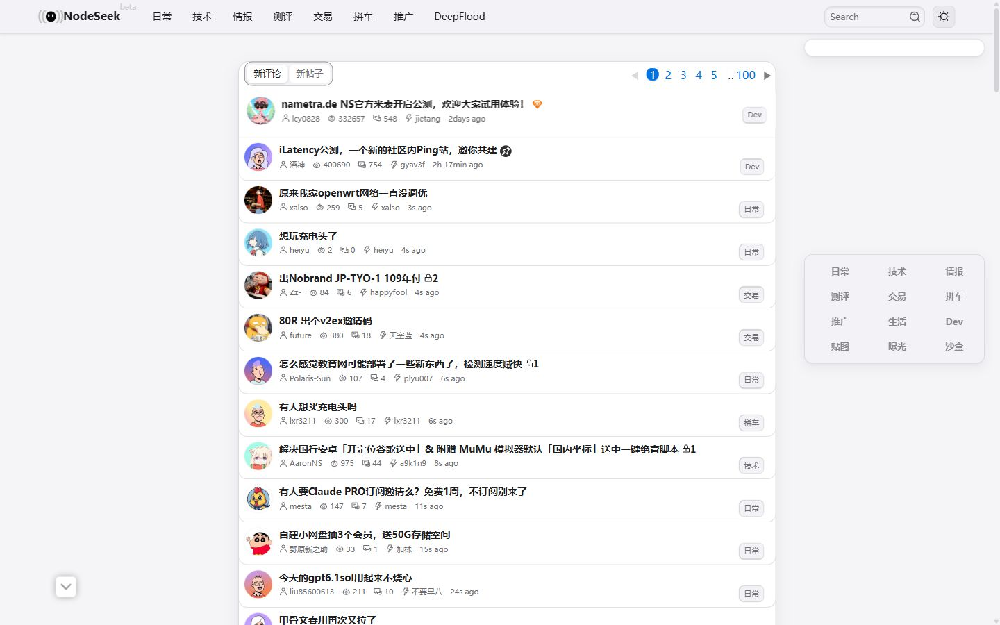 | 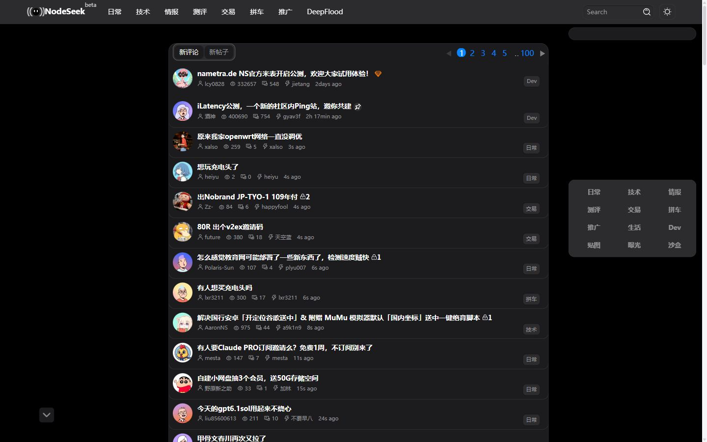 |
| **Eye-care** | 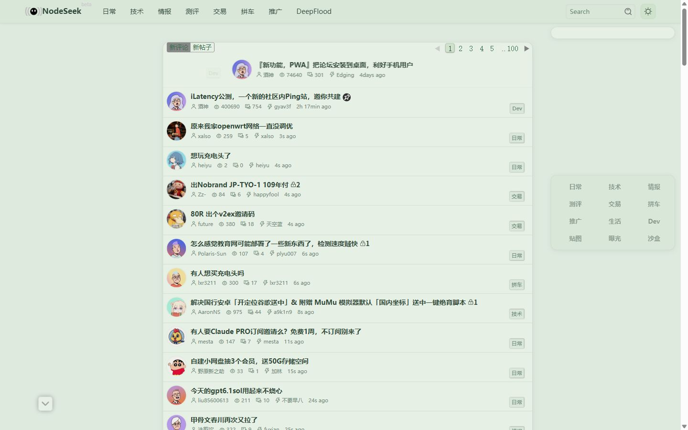 | 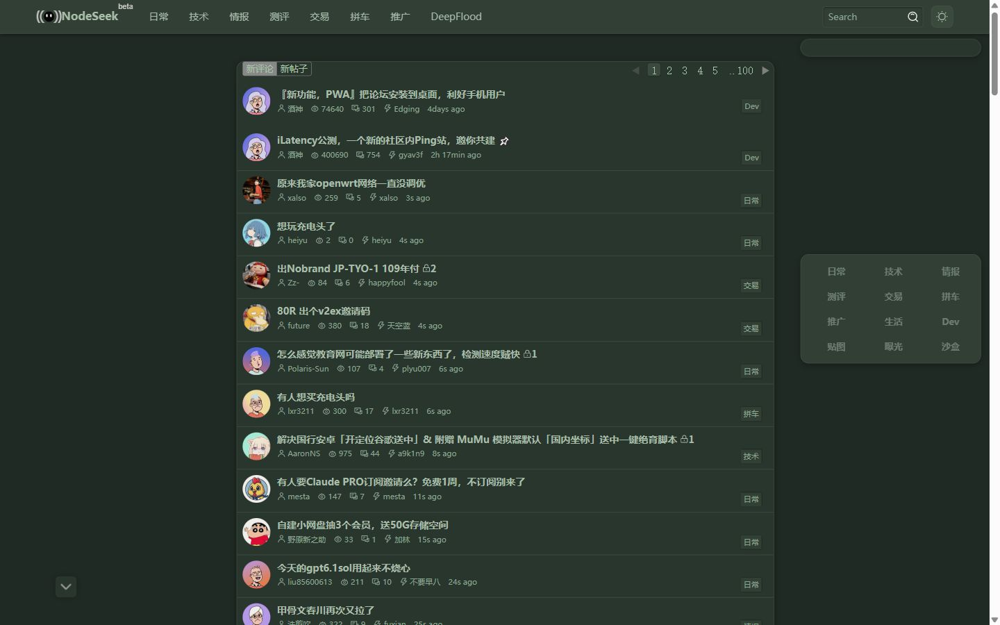 |
| **OLED black** | 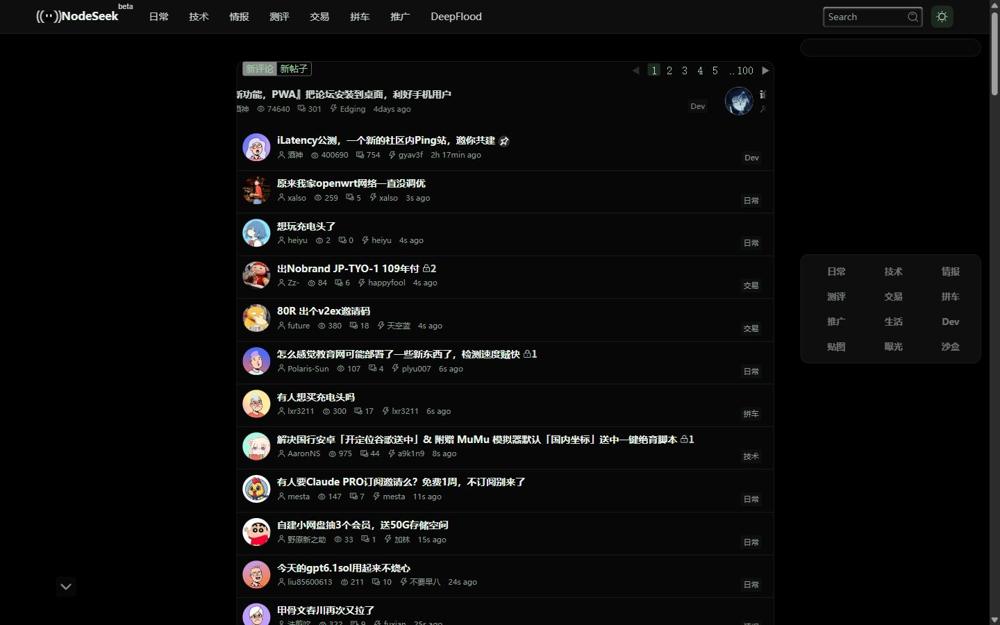 | 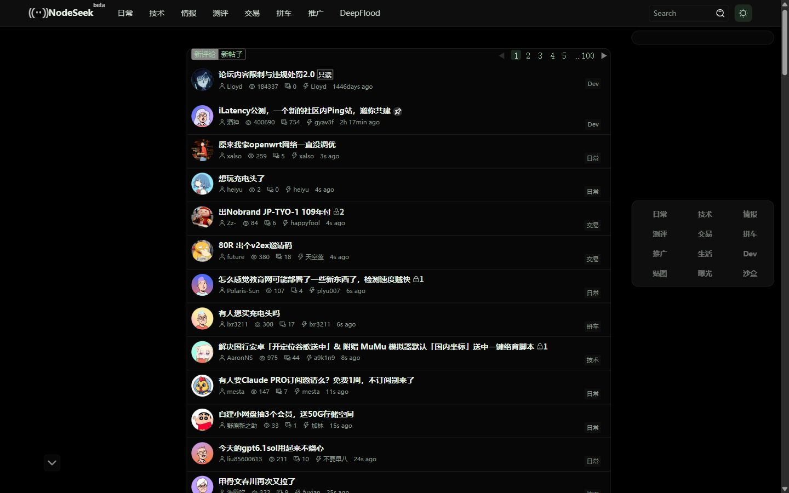 |
| **High contrast** | 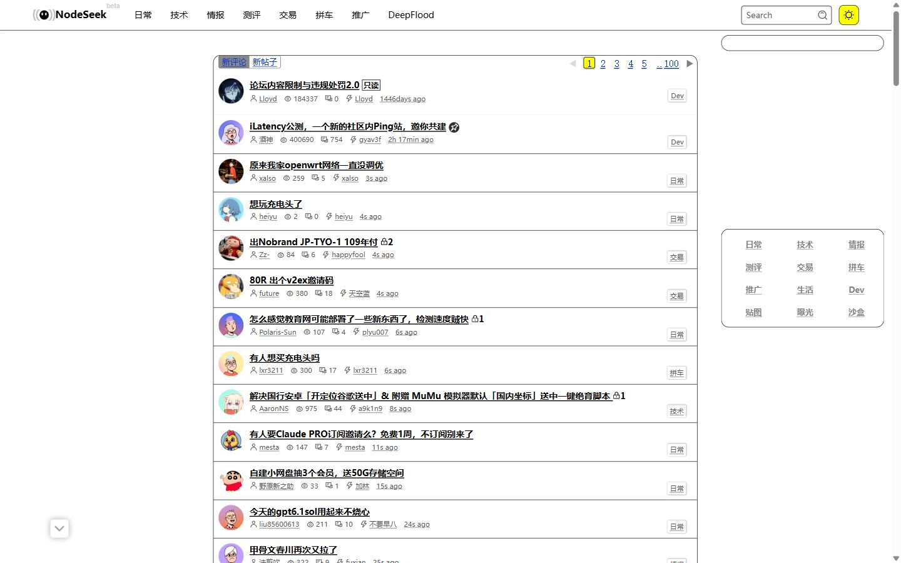 | 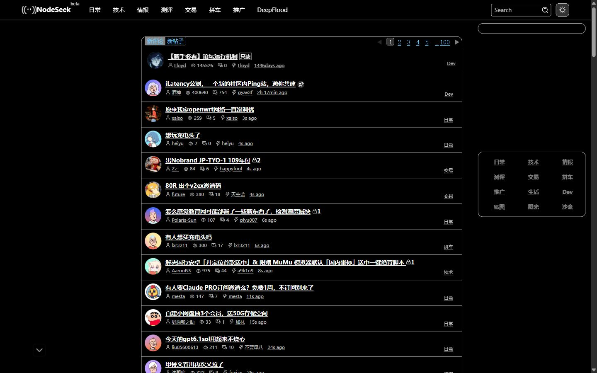 |
| **Terminal** | 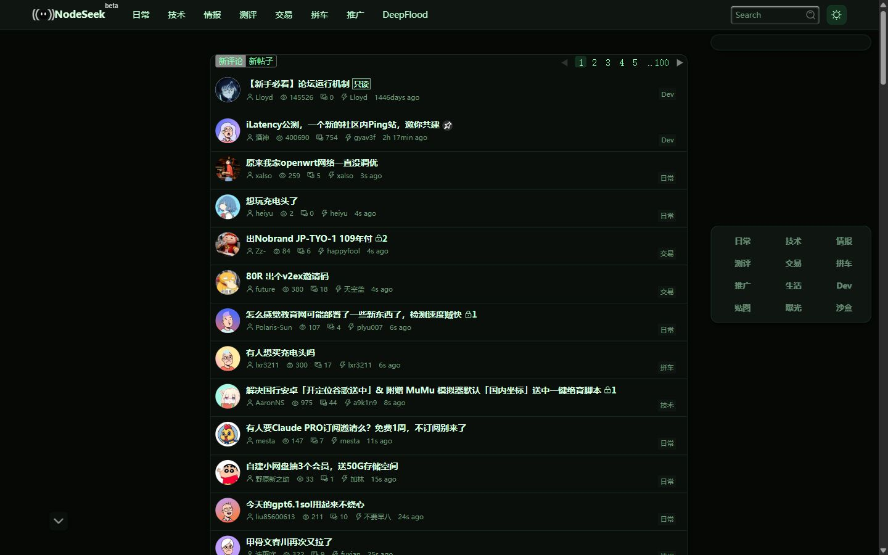 | 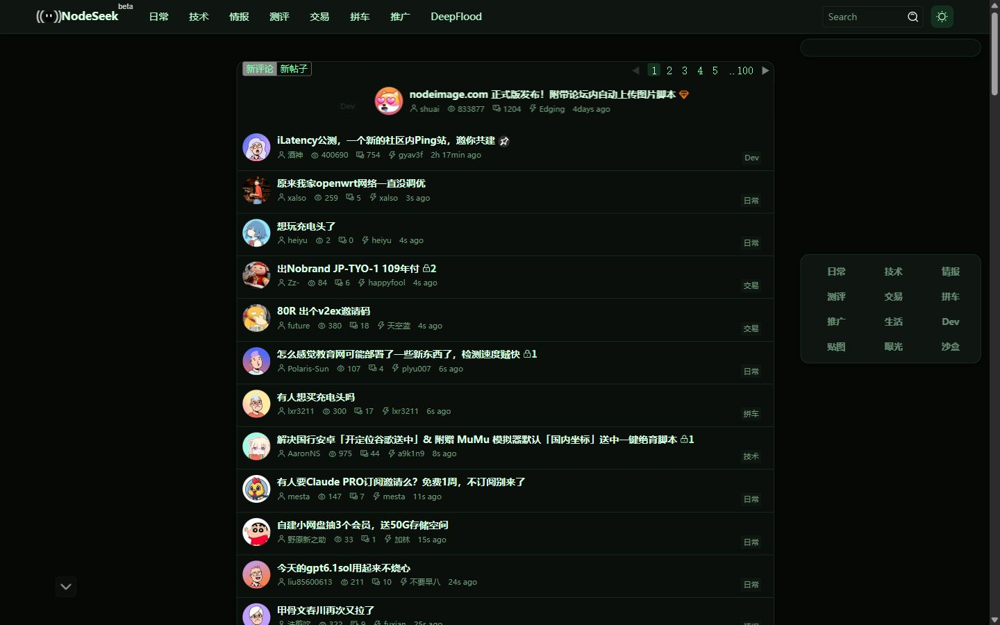 |
| **Sepia** | 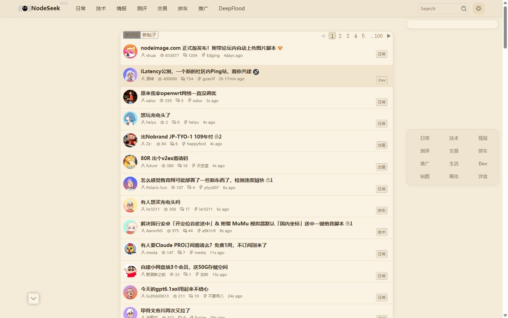 | 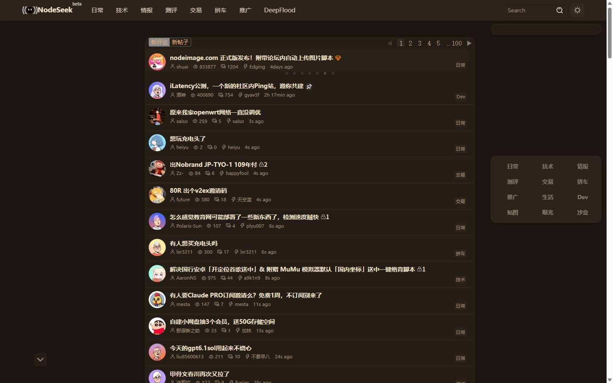 |
| **Nord** | 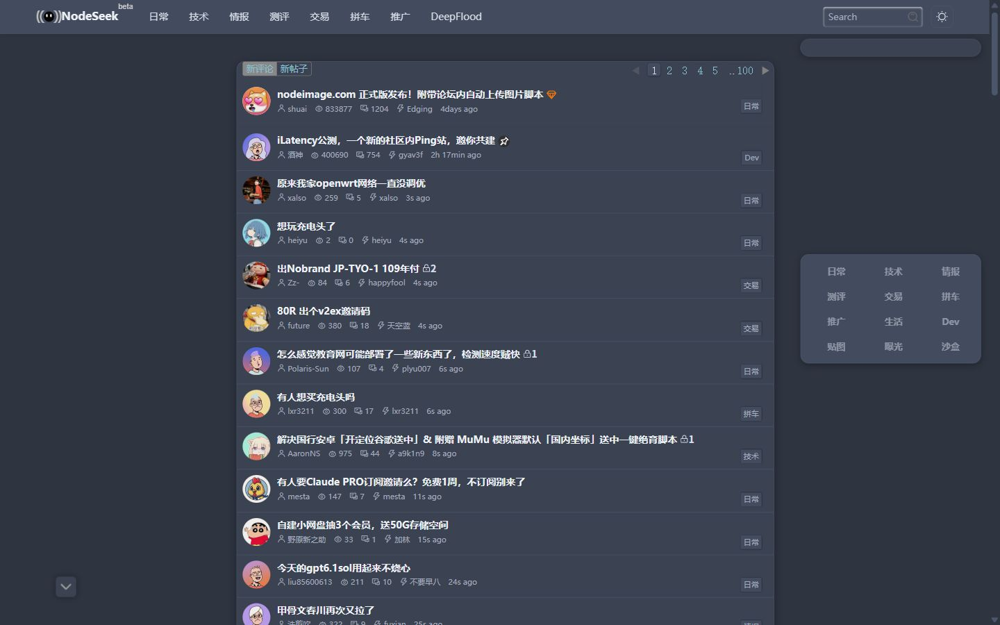 | 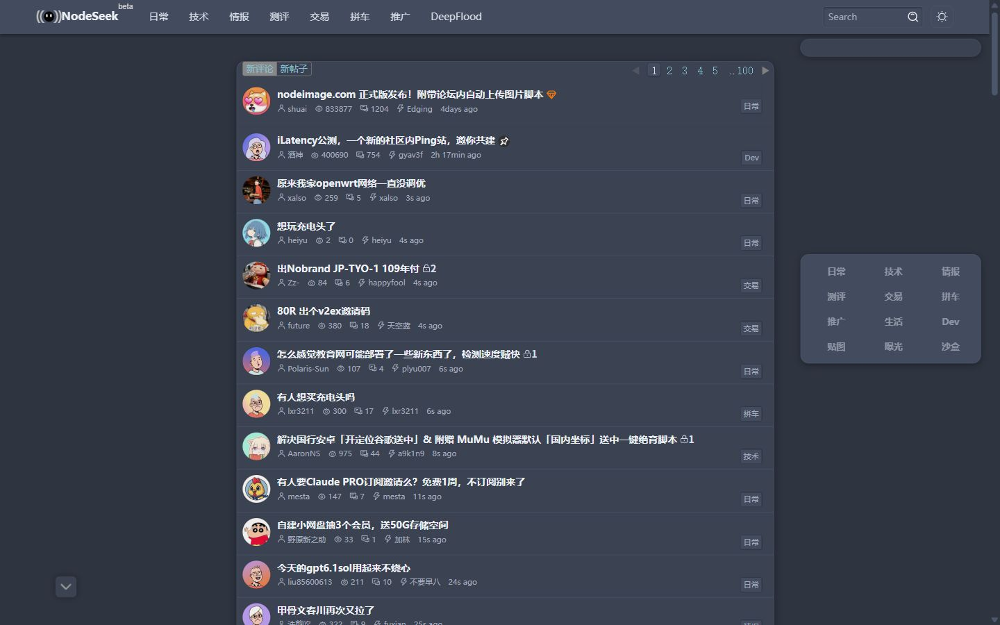 |
| **Solarized** | 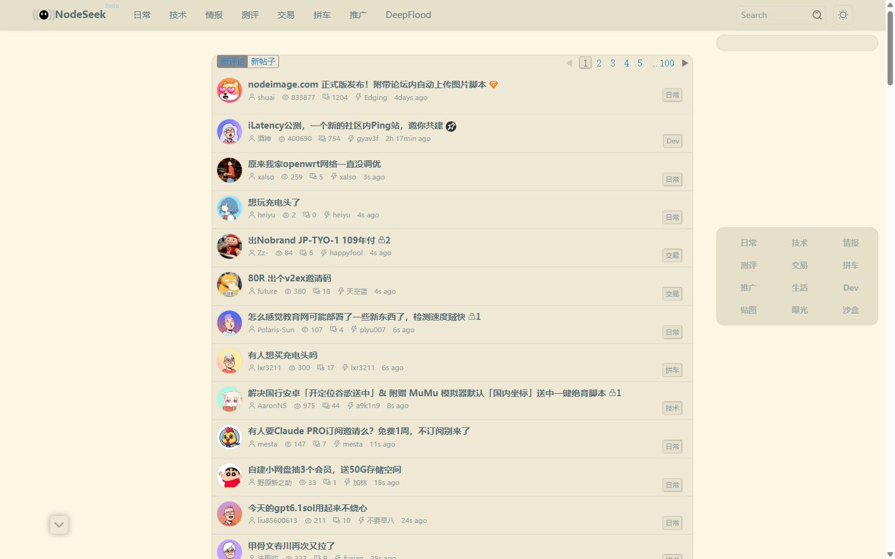 | 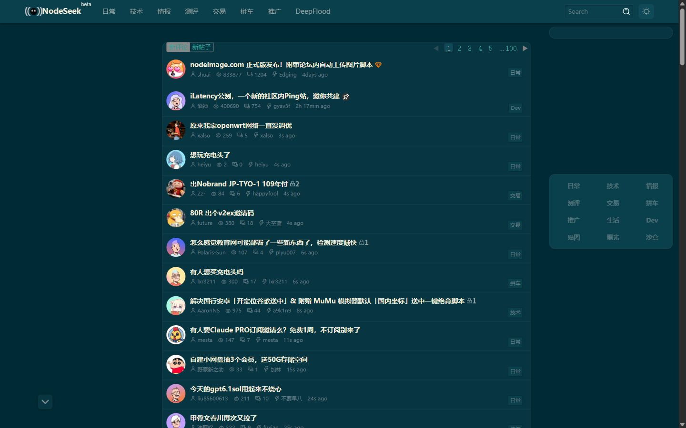 |

Screenshots are real captures of nodeseek.com (2026-11-09, Chrome, 1440×900).

## Themes (8 — pick exactly one)

| Theme | Look | Import |
|---|---|---|
| **Apple** | System white/black, blue accent, rounded corners; Apple UI details included | `@import url("https://cdn.jsdelivr.net/gh/youbilin/nodeseek-themes@v1.10.3/themes/apple.css");` |
| **Eye-care** | Warm paper green, desaturated badges, dark-mode support, floating desktop category dock | `@import url("https://cdn.jsdelivr.net/gh/youbilin/nodeseek-themes@v1.10.3/themes/eye-care.css");` |
| **OLED black** | True-black canvas, near-black cards, black in both modes | `@import url("https://cdn.jsdelivr.net/gh/youbilin/nodeseek-themes@v1.10.3/themes/oled-black.css");` |
| **High contrast** | Black/white, focus rings, link underlines, reduced motion, forced-colors | `@import url("https://cdn.jsdelivr.net/gh/youbilin/nodeseek-themes@v1.10.3/themes/high-contrast.css");` |
| **Terminal** | Black background, phosphor green, pairs with the terminal IP card | `@import url("https://cdn.jsdelivr.net/gh/youbilin/nodeseek-themes@v1.10.3/themes/terminal.css");` |
| **Sepia** | Kraft-paper palette with a warm dark mode | `@import url("https://cdn.jsdelivr.net/gh/youbilin/nodeseek-themes@v1.10.3/themes/sepia.css");` |
| **Nord** | Polar Night dark + Frost blue links | `@import url("https://cdn.jsdelivr.net/gh/youbilin/nodeseek-themes@v1.10.3/themes/nord.css");` |
| **Solarized** | Solarized light + dark | `@import url("https://cdn.jsdelivr.net/gh/youbilin/nodeseek-themes@v1.10.3/themes/solarized.css");` |

Every theme bundles the eye-care structural base and mobile fixes. **Never import two themes.**

## Modules (13 — optional, stack after the theme)

| Module | Purpose | Import |
|---|---|---|
| **Compact** | Desktop only; tighter list rows, avatars, comment spacing | `@import url("https://cdn.jsdelivr.net/gh/youbilin/nodeseek-themes@v1.10.3/modules/compact.css");` |
| **Reading** | Body size/leading, headings, quotes, images, post anchors; code & table styles inlined | `@import url("https://cdn.jsdelivr.net/gh/youbilin/nodeseek-themes@v1.10.3/modules/reading.css");` |
| **Code & tables** | Standalone code blocks and tables | `@import url("https://cdn.jsdelivr.net/gh/youbilin/nodeseek-themes@v1.10.3/modules/code-tables.css");` |
| **Zen** | Hides footer, sidebar ads, carousel, promoted badges, signature | `@import url("https://cdn.jsdelivr.net/gh/youbilin/nodeseek-themes@v1.10.3/modules/zen.css");` |
| **Mobile** | Mobile only; two-row header, 375px overflow fixes, touch targets — for the native theme | `@import url("https://cdn.jsdelivr.net/gh/youbilin/nodeseek-themes@v1.10.3/modules/mobile.css");` |
| **Glass** | Translucent panels with backdrop-filter; not with zen/OLED | `@import url("https://cdn.jsdelivr.net/gh/youbilin/nodeseek-themes@v1.10.3/modules/glass.css");` |
| **Background** | Default mountain photo + translucent cards; separate desktop/touch code paths | `@import url("https://cdn.jsdelivr.net/gh/youbilin/nodeseek-themes@v1.10.3/modules/background.css");` |
| **IP card** | Terminal-style visitor IP card, bottom right; hidden on mobile; not clickable | `@import url("https://cdn.jsdelivr.net/gh/youbilin/nodeseek-themes@v1.10.3/modules/ip-card.css");` |
| **Focus** | Hides avatars, signatures, view counts, category badges | `@import url("https://cdn.jsdelivr.net/gh/youbilin/nodeseek-themes@v1.10.3/modules/focus.css");` |
| **Fonts** | Local CJK font stack; serif body, sans UI | `@import url("https://cdn.jsdelivr.net/gh/youbilin/nodeseek-themes@v1.10.3/modules/fonts.css");` |
| **Apple UI** | Apple-style buttons, segmented controls, cards, focus rings — for non-Apple themes | `@import url("https://cdn.jsdelivr.net/gh/youbilin/nodeseek-themes@v1.10.3/modules/apple-ui.css");` |
| **Progress** | 3px top reading-progress bar; Chromium/Safari only | `@import url("https://cdn.jsdelivr.net/gh/youbilin/nodeseek-themes@v1.10.3/modules/progress.css");` |
| **Full width** | Desktop only; hides side rails, centers content at 1080px | `@import url("https://cdn.jsdelivr.net/gh/youbilin/nodeseek-themes@v1.10.3/modules/full-width.css");` |

### Stacking notes

- **Reading already inlines code & tables** — don't stack code-tables with reading.
- Themes already include **mobile**; only stack mobile on the native theme.
- **Apple already includes Apple UI** — don't stack apple-ui on it.
- Glass conflicts with zen and OLED-black (it needs background depth).
- Progress is invisible on Firefox (CSS-only, no fallback).
- The background module ships a ~650KB default photo; the IP card requests card.net.coffee.

## Combos

**Eye-care reading**

```css
@import url("https://cdn.jsdelivr.net/gh/youbilin/nodeseek-themes@v1.10.3/themes/eye-care.css");
@import url("https://cdn.jsdelivr.net/gh/youbilin/nodeseek-themes@v1.10.3/modules/reading.css");
@import url("https://cdn.jsdelivr.net/gh/youbilin/nodeseek-themes@v1.10.3/modules/zen.css");
```

**Terminal focus**

```css
@import url("https://cdn.jsdelivr.net/gh/youbilin/nodeseek-themes@v1.10.3/themes/terminal.css");
@import url("https://cdn.jsdelivr.net/gh/youbilin/nodeseek-themes@v1.10.3/modules/focus.css");
@import url("https://cdn.jsdelivr.net/gh/youbilin/nodeseek-themes@v1.10.3/modules/fonts.css");
@import url("https://cdn.jsdelivr.net/gh/youbilin/nodeseek-themes@v1.10.3/modules/reading.css");
```

**Background glass**

```css
@import url("https://cdn.jsdelivr.net/gh/youbilin/nodeseek-themes@v1.10.3/themes/eye-care.css");
@import url("https://cdn.jsdelivr.net/gh/youbilin/nodeseek-themes@v1.10.3/modules/background.css");
@import url("https://cdn.jsdelivr.net/gh/youbilin/nodeseek-themes@v1.10.3/modules/glass.css");
```

**OLED reading**

```css
@import url("https://cdn.jsdelivr.net/gh/youbilin/nodeseek-themes@v1.10.3/themes/oled-black.css");
@import url("https://cdn.jsdelivr.net/gh/youbilin/nodeseek-themes@v1.10.3/modules/reading.css");
@import url("https://cdn.jsdelivr.net/gh/youbilin/nodeseek-themes@v1.10.3/modules/ip-card.css");
```

## Use your own background

After importing the background module, paste this **anywhere** in the field (before or after the import lines):

```css
:root{
  --nsk-bg-image:url("https://example.com/your-photo.jpg");
  --nsk-bg-overlay:rgba(0,0,0,.25);
}
```

- `--nsk-bg-image`: your image (local file, data URI or a hotlink); falls back to the default mountain photo
- `--nsk-bg-overlay`: dim wash; add one over light photos to keep text readable
- `--nsk-bg-surface` / `--nsk-bg-surface-dark`: card translucency, separate for light/dark

## Versioning & mirrors

- **Pinned (recommended)**: keep `@v1.10.3` in the URL; bump the tag to upgrade.
- **Bleeding edge**: replace the tag with `@main` — may contain unreleased changes.
- **Mirrors**: swap only the host if jsDelivr is slow or blocked — `fastly.jsdelivr.net` or `gcore.jsdelivr.net`.

## Fallback: copy-paste

Every published file is self-contained: open any file under [themes/](themes/) or [modules/](modules/), copy it whole, and paste it into the custom CSS field — identical result to `@import`.

<details>
<summary><strong>FAQ</strong></summary>

- **Nothing changed after importing?** The `@import` must be the first line of the field; any rule above it makes the browser drop the whole import.
- **Edits not showing up?** jsDelivr caches a tag forever — bump the version to get new files; use `@main` temporarily while debugging.
- **Browser requirements for the floating dock?** CSS anchor positioning needs Chrome/Edge 125+ or Safari 26+; older browsers fall back to the native left sidebar.
- **Old URLs after the repo rename?** GitHub redirects them; old jsDelivr URLs are not guaranteed long-term — switch to the new name.
- **Can I hide just one thing?** Yes — every block in zen/focus is independent; delete the rules you don't want.

</details>

<details>
<summary><strong>Compatibility matrix</strong></summary>

| Pack | Desktop | Mobile | Light/Dark | Notes |
|---|---|---|---|---|
| apple | full | full | full | includes mobile + Apple UI |
| eye-care | full | full | full | includes mobile |
| oled-black | full | full | all black | includes mobile |
| high-contrast | full | full | full | prefers-contrast/forced-colors |
| terminal | full | full | all black | includes mobile |
| sepia | full | full | full | includes mobile |
| nord | full | full | all dark | includes mobile |
| solarized | full | full | full | includes mobile |
| compact | full | n/a | full | desktop only |
| reading | full | full | full | code-tables inlined |
| code-tables | full | full | full | standalone ok |
| zen | full | full | full | hides signature |
| mobile | n/a | full | full | for the native theme |
| glass | full | full | full | not with zen/OLED |
| background | full | full | full | separate touch path |
| ip-card | full | hidden | full | third-party request |
| focus | full | full | full | hides secondary info |
| fonts | full | full | full | local fonts |
| apple-ui | full | full | full | for non-Apple themes |
| progress | full | full | full | Chromium/Safari |
| full-width | full | n/a | full | hides side rails |

Full matrix in [docs/compatibility.md](docs/compatibility.md). Tested 2026-11-09.

</details>

## Development

Published files are assembled by `build.mjs` from `src/` (`src/base/eye-care.css` + `src/themes/*.overlay.css`); `modules/reading.css` inlines `code-tables.css`. Edit `src/`, run `npm run build`, tag a release (e.g. `v1.10.3`) and sync the version in this README — jsDelivr picks the tag up immediately.

```
themes/        8 self-contained themes
modules/       13 self-contained modules
src/base/      eye-care base source
src/themes/    theme overlay sources
src/modules/   module sources
build.mjs      build script
screenshots/   README screenshots
docs/          compatibility docs
```

## Related

CSS can't do interactions — those live in [youbilin/nodeseek-userscript](https://github.com/youbilin/nodeseek-userscript): clickable IP card, keyboard shortcuts, link hover previews, local contacts.

## Known limitations

- CSS cannot add a DM contact bar, change the send shortcut, or generate link preview cards — see the userscript repo.
- zen hides signatures and focus hides category badges by default; delete the blocks you want to keep.
- Themes and modules depend on NodeSeek's current class names; retest after major site updates.
- `@import` requires access to jsDelivr; switch to a mirror or the copy-paste fallback if blocked.

## Versioning

- Current: `v1.10.3`
- Scheme: `vMAJOR.MINOR.PATCH` — new files/overrides = MINOR, fixes = PATCH, breaking import changes = MAJOR.
- Pin a version; don't point production at `@latest`.
