<div align="center">

# NodeSeek Themes

**NodeSeek 论坛自定义 CSS 主题与模块**

[](https://github.com/youbilin/nodeseek-themes/tags)
[](https://www.jsdelivr.com/package/gh/youbilin/nodeseek-themes)


[English](README.en.md) | **简体中文**

一行 `@import`，整站换装。

</div>

---

## 快速开始

NodeSeek → **设置 → 扩展 → 自定义 CSS**，粘贴这一行，保存，刷新页面：

```css
@import url("https://cdn.jsdelivr.net/gh/youbilin/nodeseek-themes@v1.10.3/themes/apple.css");
```

换风格只改文件名；加模块在下面再来一行。

> **唯一要注意的**：所有 `@import` 必须放在自定义 CSS 的**最顶部**，前面不能有任何其他样式规则。CSS 规定 `@import` 只能出现在其他规则之前，位置不对会被浏览器直接忽略。

已在 nodeseek.com 实测（2026-11-09，Chrome）：CDN 导入返回 200，主题变量正常生效。

## 主题预览

| 主题 | 亮色 | 暗色 |
|---|---|---|
| **Apple** | 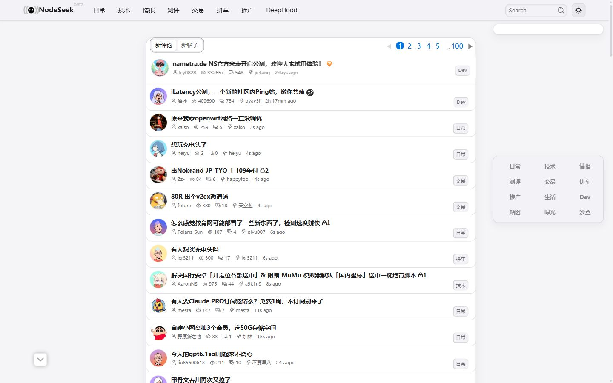 | 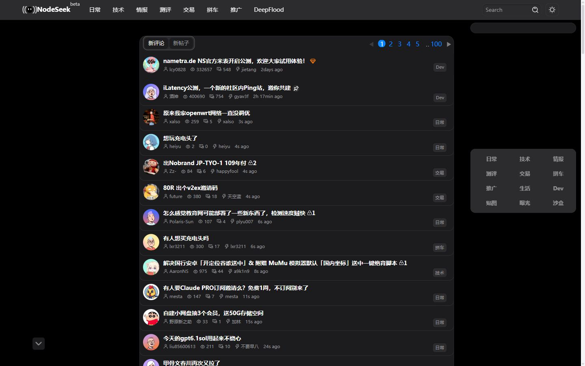 |
| **护眼** | 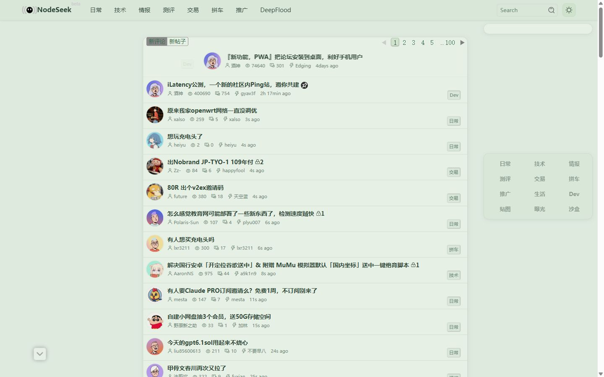 | 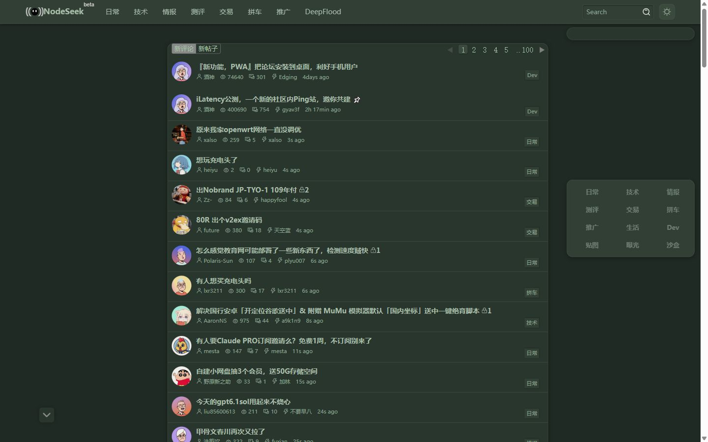 |
| **OLED 纯黑** | 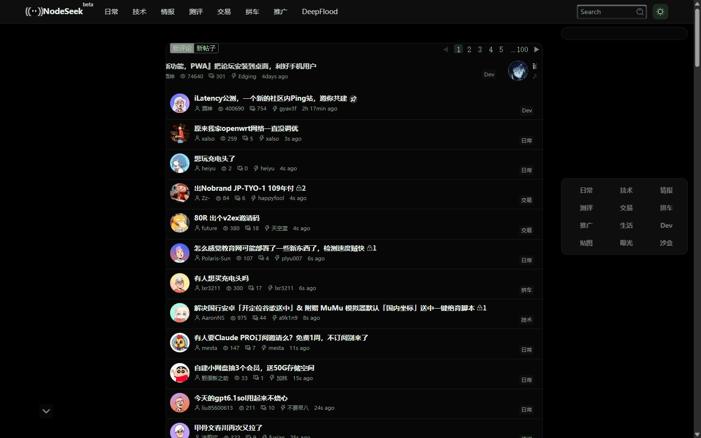 | 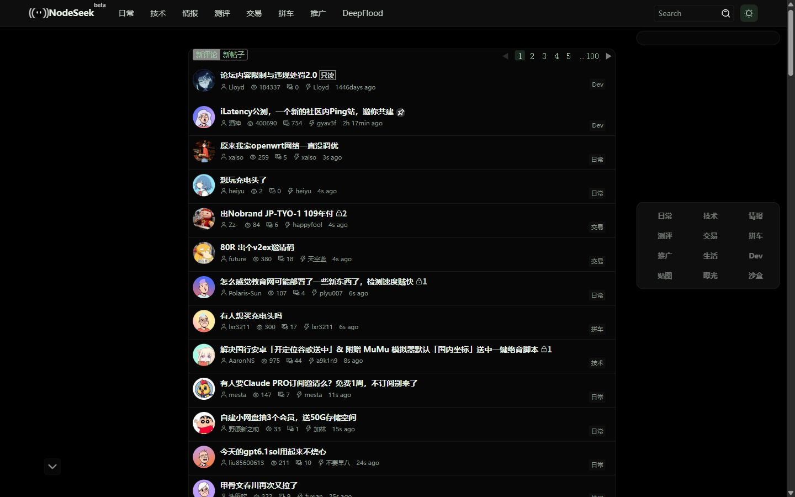 |
| **高对比** | 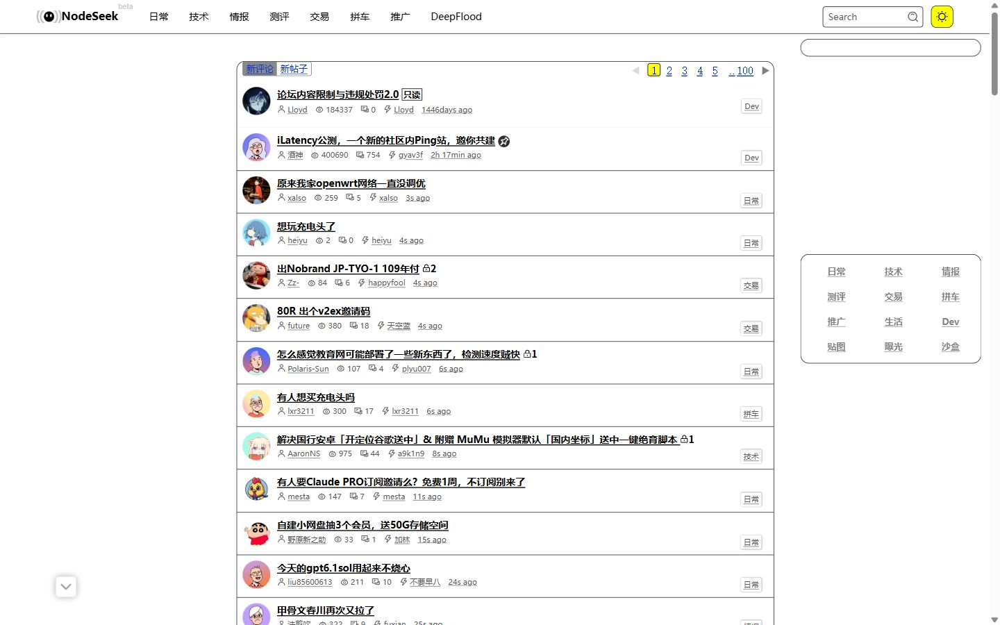 | 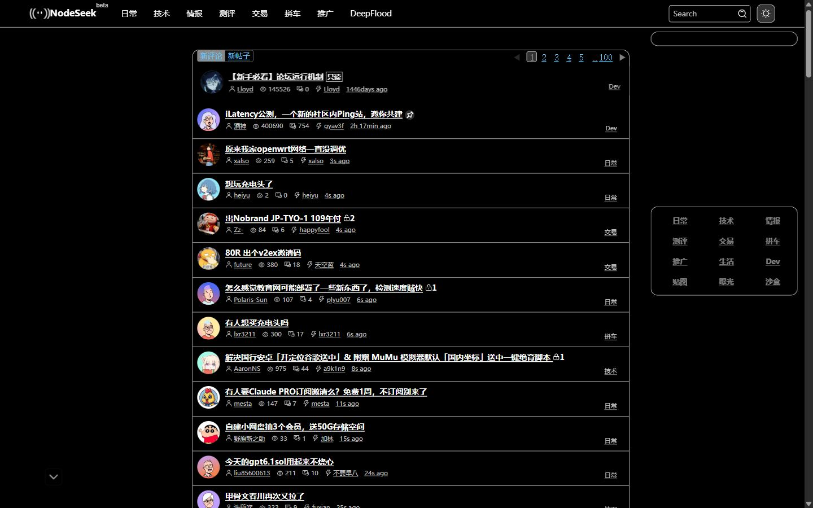 |
| **终端绿** | 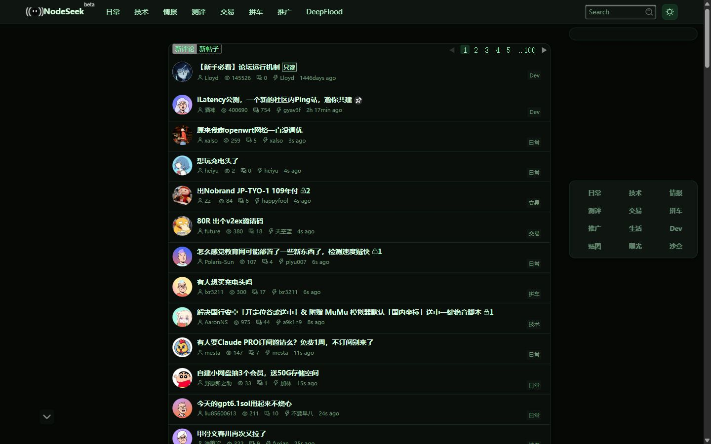 | 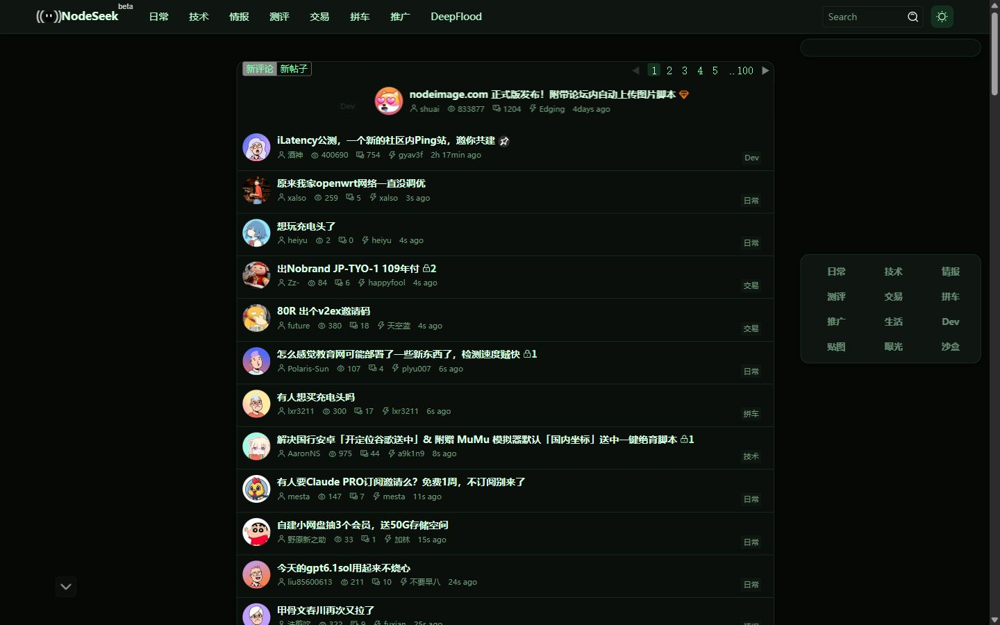 |
| **暖纸** | 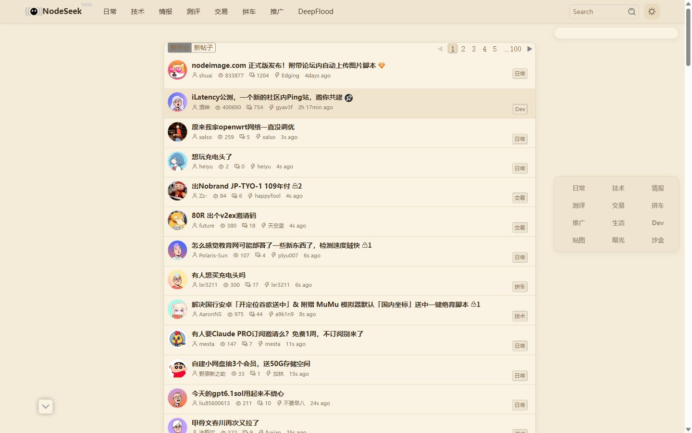 | 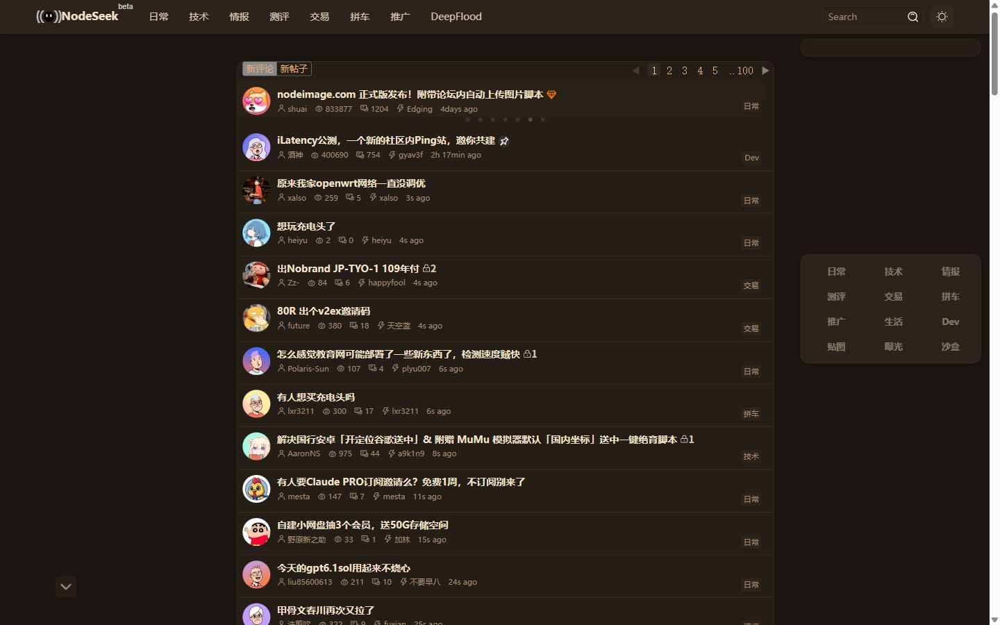 |
| **Nord** | 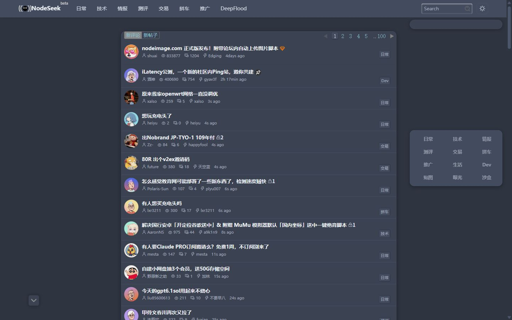 | 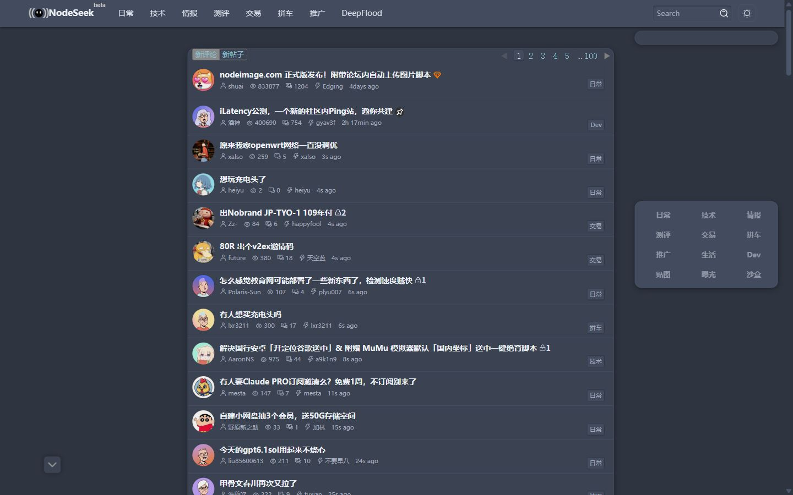 |
| **Solarized** | 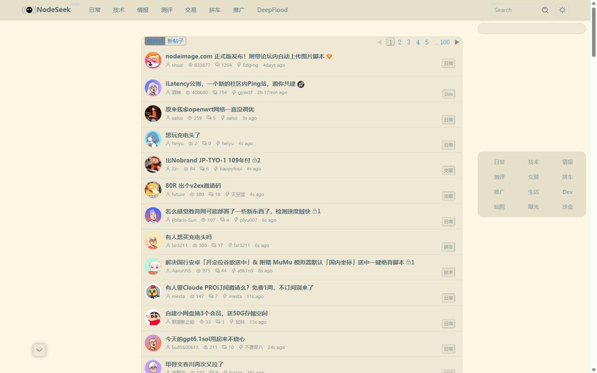 | 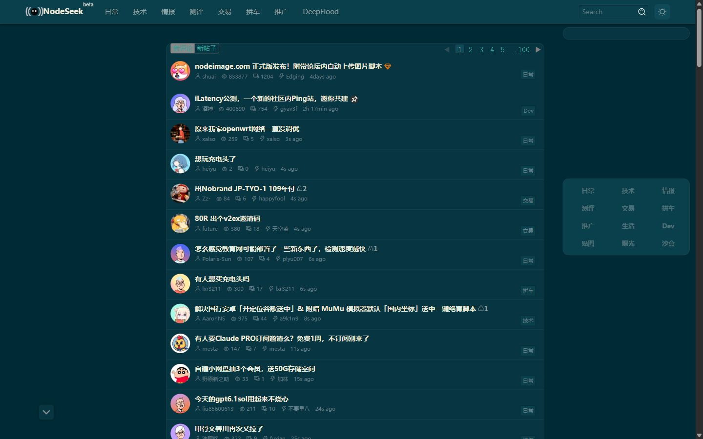 |

截图为 nodeseek.com 首页实拍（2026-11-09，Chrome，1440×900）。

## 主题（8 个，互斥，只选一个）

| 主题 | 风格 | 导入 |
|---|---|---|
| **Apple** | 系统白/黑、蓝色强调、圆角轻阴影；已内置 Apple UI 细节 | `@import url("https://cdn.jsdelivr.net/gh/youbilin/nodeseek-themes@v1.10.3/themes/apple.css");` |
| **护眼** | 暖纸绿、低饱和图片/徽章、暗色适配、桌面悬浮分类栏 | `@import url("https://cdn.jsdelivr.net/gh/youbilin/nodeseek-themes@v1.10.3/themes/eye-care.css");` |
| **OLED 纯黑** | 纯黑画布、近黑卡片，亮/暗模式都是黑 | `@import url("https://cdn.jsdelivr.net/gh/youbilin/nodeseek-themes@v1.10.3/themes/oled-black.css");` |
| **高对比** | 黑白高对比、焦点环、链接下划线、减少动效、forced-colors | `@import url("https://cdn.jsdelivr.net/gh/youbilin/nodeseek-themes@v1.10.3/themes/high-contrast.css");` |
| **终端绿** | 黑底荧光绿，和 terminal 风格 IP 卡最搭 | `@import url("https://cdn.jsdelivr.net/gh/youbilin/nodeseek-themes@v1.10.3/themes/terminal.css");` |
| **暖纸** | 牛皮纸/暖纸配色，含暖暗色模式 | `@import url("https://cdn.jsdelivr.net/gh/youbilin/nodeseek-themes@v1.10.3/themes/sepia.css");` |
| **Nord** | Polar Night 深色 + Frost 蓝链接 | `@import url("https://cdn.jsdelivr.net/gh/youbilin/nodeseek-themes@v1.10.3/themes/nord.css");` |
| **Solarized** | Solarized 亮色 + 暗色两套 | `@import url("https://cdn.jsdelivr.net/gh/youbilin/nodeseek-themes@v1.10.3/themes/solarized.css");` |

每个主题文件已包含 eye-care 结构底座和移动端修复，**不要同时导入两个主题**。

## 模块（13 个，按需追加）

写在主题那行下面，全部保持在最顶部。

| 模块 | 作用 | 导入 |
|---|---|---|
| **紧凑密度** | 仅桌面，压缩列表行高、头像和评论间距 | `@import url("https://cdn.jsdelivr.net/gh/youbilin/nodeseek-themes@v1.10.3/modules/compact.css");` |
| **阅读排版** | 正文字号/行高、标题、引用、图片、楼层锚点；已内联代码/表格样式 | `@import url("https://cdn.jsdelivr.net/gh/youbilin/nodeseek-themes@v1.10.3/modules/reading.css");` |
| **代码与表格** | 只想要代码块和表格时单独用 | `@import url("https://cdn.jsdelivr.net/gh/youbilin/nodeseek-themes@v1.10.3/modules/code-tables.css");` |
| **极简净化** | 隐藏页脚、侧栏广告、轮播、推荐角标、快捷功能区、新用户面板、签名 | `@import url("https://cdn.jsdelivr.net/gh/youbilin/nodeseek-themes@v1.10.3/modules/zen.css");` |
| **移动可用性** | 仅移动端：两行头部、修复 375px 溢出、触摸目标；给原生主题用 | `@import url("https://cdn.jsdelivr.net/gh/youbilin/nodeseek-themes@v1.10.3/modules/mobile.css");` |
| **玻璃拟态** | 半透明面板 + backdrop-filter 模糊；不要和 zen/OLED 叠用 | `@import url("https://cdn.jsdelivr.net/gh/youbilin/nodeseek-themes@v1.10.3/modules/glass.css");` |
| **自定义背景** | 默认山景图 + 半透明卡片；移动端与桌面端分别适配 | `@import url("https://cdn.jsdelivr.net/gh/youbilin/nodeseek-themes@v1.10.3/modules/background.css");` |
| **访客 IP 卡片** | 右下角 terminal 风格 IP 卡；移动端默认隐藏；CSS 不可点击 | `@import url("https://cdn.jsdelivr.net/gh/youbilin/nodeseek-themes@v1.10.3/modules/ip-card.css");` |
| **专注** | 隐藏头像、签名、浏览量、最后回复、分类徽章 | `@import url("https://cdn.jsdelivr.net/gh/youbilin/nodeseek-themes@v1.10.3/modules/focus.css");` |
| **字体** | 本地 CJK 字体栈；正文衬线、UI 无衬线 | `@import url("https://cdn.jsdelivr.net/gh/youbilin/nodeseek-themes@v1.10.3/modules/fonts.css");` |
| **Apple UI** | Apple 风格按钮按压、分段控件、圆角卡片、焦点环；给非 Apple 主题用 | `@import url("https://cdn.jsdelivr.net/gh/youbilin/nodeseek-themes@v1.10.3/modules/apple-ui.css");` |
| **阅读进度** | 顶部 3px 进度条；Chromium/Safari 支持，Firefox 不显示 | `@import url("https://cdn.jsdelivr.net/gh/youbilin/nodeseek-themes@v1.10.3/modules/progress.css");` |
| **全宽** | 仅桌面，隐藏左右栏，内容居中 1080px | `@import url("https://cdn.jsdelivr.net/gh/youbilin/nodeseek-themes@v1.10.3/modules/full-width.css");` |

### 叠加注意

- **阅读排版已内联代码与表格**，导入了 reading 就不要再导入 code-tables。
- 主题已含 mobile，**用本仓库主题就不要再导入 mobile**。
- **Apple 主题已内置 Apple UI 细节**，不要再导入 apple-ui。
- 玻璃拟态不要和 zen、OLED 主题叠用。
- 全宽会隐藏左右栏和侧栏的发帖按钮；阅读进度在 Firefox 不显示。
- 自定义背景默认图片约 650KB；IP 卡片会请求 card.net.coffee。

## 常用组合

**护眼阅读**

```css
@import url("https://cdn.jsdelivr.net/gh/youbilin/nodeseek-themes@v1.10.3/themes/eye-care.css");
@import url("https://cdn.jsdelivr.net/gh/youbilin/nodeseek-themes@v1.10.3/modules/reading.css");
@import url("https://cdn.jsdelivr.net/gh/youbilin/nodeseek-themes@v1.10.3/modules/zen.css");
```

**终端专注**

```css
@import url("https://cdn.jsdelivr.net/gh/youbilin/nodeseek-themes@v1.10.3/themes/terminal.css");
@import url("https://cdn.jsdelivr.net/gh/youbilin/nodeseek-themes@v1.10.3/modules/focus.css");
@import url("https://cdn.jsdelivr.net/gh/youbilin/nodeseek-themes@v1.10.3/modules/fonts.css");
@import url("https://cdn.jsdelivr.net/gh/youbilin/nodeseek-themes@v1.10.3/modules/reading.css");
```

**背景玻璃**

```css
@import url("https://cdn.jsdelivr.net/gh/youbilin/nodeseek-themes@v1.10.3/themes/eye-care.css");
@import url("https://cdn.jsdelivr.net/gh/youbilin/nodeseek-themes@v1.10.3/modules/background.css");
@import url("https://cdn.jsdelivr.net/gh/youbilin/nodeseek-themes@v1.10.3/modules/glass.css");
```

**OLED 阅读**

```css
@import url("https://cdn.jsdelivr.net/gh/youbilin/nodeseek-themes@v1.10.3/themes/oled-black.css");
@import url("https://cdn.jsdelivr.net/gh/youbilin/nodeseek-themes@v1.10.3/modules/reading.css");
@import url("https://cdn.jsdelivr.net/gh/youbilin/nodeseek-themes@v1.10.3/modules/ip-card.css");
```

## 换上你自己的背景

导入 background 模块后，把这段贴到自定义 CSS 的**任意位置**（import 行前面或后面都行）：

```css
:root{
  --nsk-bg-image:url("https://example.com/your-photo.jpg");
  --nsk-bg-overlay:rgba(0,0,0,.25);
}
```

- `--nsk-bg-image`：你的图片地址（本地文件、data URI、外链都行）；不设就用默认山景图
- `--nsk-bg-overlay`：压暗层；浅色照片建议加一点，保证卡片外文字可读
- `--nsk-bg-surface` / `--nsk-bg-surface-dark`：卡片透明度，亮/暗模式分开设置

## 升级与镜像

- **固定版本（推荐）**：URL 里的 `@v1.10.3`。升级时改版本号，刷新即生效。
- **跟最新**：换成 `@main`。可能包含未发布改动，日常不建议。
- **镜像**：jsDelivr 慢或被拦时只换域名：`fastly.jsdelivr.net` / `gcore.jsdelivr.net`。

## 备用：复制粘贴

文件本身自包含：打开 [themes/](themes/) 或 [modules/](modules/) 里的文件，全选复制粘到自定义 CSS，效果与 `@import` 一致。

<details>
<summary><strong>常见问题</strong></summary>

- **导入后没变化？** `@import` 必须在输入框第一行，前面有任何规则整条导入都会被忽略。
- **改了样式没生效？** jsDelivr 按 tag 永久缓存，改版本号才拿得到新文件；调试可临时用 `@main`。
- **悬浮分类栏需要什么浏览器？** CSS 锚点定位需要 Chrome/Edge 125+ 或 Safari 26+；旧浏览器自动退回原生左侧栏。
- **仓库改名后旧地址还能用吗？** GitHub 自动跳转；旧 jsDelivr 地址不保证长期可用，建议换新地址。
- **能只隐藏某一部分吗？** 可以，zen/focus 每个规则块独立，删掉对应规则即可。

</details>

<details>
<summary><strong>兼容性矩阵</strong></summary>

| 包 | 桌面 | 移动 | 亮/暗 | 备注 |
|---|---|---|---|---|
| apple | full | full | full | 已含 mobile + Apple UI |
| eye-care | full | full | full | 已含 mobile |
| oled-black | full | full | 全黑 | 已含 mobile |
| high-contrast | full | full | full | 支持 prefers-contrast/forced-colors |
| terminal | full | full | 全黑 | 已含 mobile |
| sepia | full | full | full | 已含 mobile |
| nord | full | full | 全暗 | 已含 mobile |
| solarized | full | full | full | 已含 mobile |
| compact | full | n/a | full | 仅桌面 |
| reading | full | full | full | 已含 code-tables |
| code-tables | full | full | full | 可单独用 |
| zen | full | full | full | 隐藏签名 |
| mobile | n/a | full | full | 给原生主题用 |
| glass | full | full | full | 避免与 zen/OLED 叠用 |
| background | full | full | full | 移动端独立适配 |
| ip-card | full | 默认隐藏 | full | 第三方请求 |
| focus | full | full | full | 隐藏次要信息 |
| fonts | full | full | full | 本地字体 |
| apple-ui | full | full | full | 给非 Apple 主题用 |
| progress | full | full | full | Chromium/Safari |
| full-width | full | n/a | full | 隐藏左右栏 |

详细矩阵见 [docs/compatibility.md](docs/compatibility.md)。测试日期：2026-11-09。

</details>

## 本地开发

- `themes/`、`modules/` 是发布产物，CDN 直接指向这些文件；`src/` 是源文件（`src/base/eye-care.css` + `src/themes/*.overlay.css`）。
- `build.mjs` 拼装产物：主题 = 底座 + 覆盖层 + apple-ui（仅 Apple）+ mobile；`modules/reading.css` 内联 code-tables。
- 改样式改 `src/`，然后 `npm run build`；发布时打 tag（如 `v1.10.3`）并同步 README 版本号。

```
themes/        8 个自包含主题
modules/       13 个自包含模块
src/base/      eye-care 底座源文件
src/themes/    主题覆盖层源文件
src/modules/   模块源文件
build.mjs      拼装脚本
screenshots/   README 截图
docs/          兼容性文档
```

## 用户脚本

CSS 做不到的交互在独立仓库：[youbilin/nodeseek-userscript](https://github.com/youbilin/nodeseek-userscript) — 可点击 IP 卡片、键盘快捷键、帖子链接悬停预览、本地联系人列表。

## 已知限制

- CSS 不能新增私信联系人栏、不能修改发送快捷键、不能生成链接预览卡；这些在 userscript 仓库。
- 极简净化默认隐藏签名；专注会隐藏分类徽章；不需要时删掉对应规则。
- 主题和模块依赖 NodeSeek 现有类名；站点大版本更新后需要重新测试。
- `@import` 依赖浏览器能访问 jsDelivr；被拦时换镜像域名或改用复制粘贴。

## 版本

- 当前：`v1.10.3`
- 版本线：`vMAJOR.MINOR.PATCH`；新增文件/覆盖 = MINOR，修复 = PATCH，破坏导入方式 = MAJOR。
- 请固定版本号；生产使用不要指向 `@latest`。
